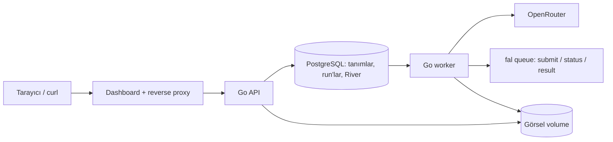

# FlowKit — uygulama ve teslim planı

Durum: kullanıcı 10 Ekim 2026'da kontrol sonrası kodlamaya geçilmesini ve GitHub reposuna push yapılmasını onayladı. Uygulama başlamıştır; kabul kontrolleri henüz yapılmış sonuçlar değildir. Sağlayıcı belgelerinin son sözleşme ayrıntıları Bölüm 9.1'de tamamlanmıştır.

## 1. Hedef ve kapsam

FlowKit, JSON olarak tanımlanan doğrusal AI workflow'larını PostgreSQL'de saklar, kaydetmeden önce doğrular ve ayrı bir worker üzerinden asenkron çalıştırır. OpenRouter metin üretimi ve fal.ai kuyruk üzerinden görsel üretimi desteklenir. Dashboard yalnızca HTTP API'yi kullanır.

Zorunlu gereksinimlerin tamamı ve kullanıcının istediği üç bonus kapsam içindedir:

- Kayıtlı fal istek kimliği üzerinden worker yeniden başlatma dayanıklılığı.
- Run oluşturma için idempotency key.
- Node ve run düzeyinde tahmini maliyet izi.

Sürükle-bırak canvas, uygulama içi kullanıcı girişi, ödeme/kredi, paralel veya dallanan workflow, alt workflow çağırma, ortamlar arası promotion ve görsel kalitesi iyileştirmesi kapsam dışıdır. Ayrı workflow run'ları eşzamanlı çalışabilir; aynı run'ın node'ları sırayla ilerler. Buluta deploy bu teslimin zorunlu parçası değildir. Eklenirse API ve dashboard birlikte parola korumasına alınır.

## 2. Mimari kararlar

| Alan | Karar | Gerekçe |
|---|---|---|
| Backend | Go, `net/http` + chi | Küçük ve açık HTTP katmanı; Go tercihiyle uyum |
| Veritabanı | PostgreSQL, pgx/v5, açık SQL | JSONB tanımlar, transaction ve kalıcı çalıştırma izi |
| SQL erişim kodu | sqlc; pgx/v5 hedefi | Elle yazılan SQL'den tipli Go kodu üretmek; parametre/sonuç eşleme yükünü azaltmak |
| Kuyruk | River; PostgreSQL üzerinde | Run ve işi aynı transaction içinde kaydetmek; ayrı Redis gerektirmemek |
| Süreçler | Ayrı API ve worker | HTTP isteğini sağlayıcı bekleme süresinden ayırmak |
| Migration | Goose SQL migration'ları; River migration'ları da init sırasında | Tekrarlanabilir ve sürümlü kurulum |
| JSON Schema | santhosh-tekuri/jsonschema; JSON Schema 2020-12 | Yapısal ve kullanıcı girdisi doğrulamasını standartlaştırmak |
| Graf doğrulama | Uygulamaya ait kurallar | Döngü, port, doğrusal yapı, katalog ve şablon ilişkileri |
| Dashboard | React + TypeScript + Vite | JSON editörü, formlar, run geçmişi ve detay için yeterli |
| Dashboard API verisi | TanStack Query | GET cache, polling, yükleniyor/hata durumları ve mutation sonrası invalidation |
| JSON editörü | CodeMirror 6; JSON language ve lint | JSON düzenleme ve sözdizimi hatalarını gösterme; semantik doğrulama API'de |
| Dashboard sunumu | Nginx: statik dosyalar + API reverse proxy | Dashboard ve API için aynı origin; tek giriş adresi |
| Durum güncelleme | Aktif run için 2 saniyede bir polling | Bu kapsamda SSE/WebSocket gerektirmeyen basit çözüm |
| Görseller | Paylaşılan kalıcı Docker volume; API'den artifact olarak sunum | Sağlayıcı URL'sinin süresine bağlı kalmamak |
| Log | Go slog, JSON handler; case/demo varsayılanı DEBUG | Run'ın bütün yaşam döngüsünü ortak alanlarla izlemek; ayrıntı seviyesi konfigüre edilebilir |

Kütüphane ve container sürümleri uygulama başlangıcında sabitlenir; lock dosyaları repoya girer. Katalog startup sırasında belleğe yüklenip sabitlenmez. API yeni run kabul ederken güncel katalogdan okur; worker kabul edilmiş run'ın snapshot'ını kullanır.



Redis, ek mesaj broker'ı ve ayrı bir outbox eklenmez: bu sistemde River iş kaydı run kaydıyla aynı PostgreSQL transaction'ına girer.

### 2.1. Güncel teknoloji araştırması ve onaylanan seçimler

10 Ekim 2026'da resmi dokümantasyon/release sayfalarıyla yapılan karşılaştırma [teknoloji değerlendirmesinde](docs/TECHNOLOGY_REVIEW.md) yer alır. Kullanıcı pgx yanında sqlc, dashboard veri yönetimi için TanStack Query ve JSON editörü için CodeMirror 6 kullanımını onaylamıştır; bu üç seçim mimari tablosuna ve ilgili uygulama/kontrol adımlarına işlenmiştir. sqlc geliştirme sırasında kod üretir; diğer ikisi dashboard bundle'ının parçasıdır. Ek kalıcı servis oluşturmazlar.

Go/PostgreSQL/River, chi, Goose, JSON Schema, React/TypeScript/Vite, Nginx ve slog seçimleri korunur. Caddy, Huma ve River resumable/checkpoint yardımcıları bu plana dahil edilmemiş araştırma seçenekleridir. Node/provider ilerlemesinin kalıcı kaynağı mevcut DB fazlarıdır; fal request ID hemen transaction ile kaydedilir. Araştırma prototip/benchmark veya gerçek provider doğrulaması değildir; seçilen bağımlılıklar henüz kurulmamış veya test edilmemiştir. Kullanıcının istediği ilk iki maddedeki kurulum/log kararları Bölüm 13 ve 17'ye uygulanmıştır.

## 3. Model kataloğu ve genişletilebilirlik

Katalog kaydı şu alanları taşır:

- `alias`: benzersiz ve değişmez referans; workflow bununla model seçer.
- `provider`: `openrouter` veya `fal`.
- `modelId`: sağlayıcıdaki gerçek model/endpoint kimliği.
- `inputProfile`: desteklenen istek/yanıt sözleşmesi.
- `defaults`: profile uygun varsayılan model parametreleri.
- `enabled`: yeni kullanım için açık/kapalı.
- `pricing`: varsa decimal fiyat bilgisi, birimi, kaynağı ve güncellenme zamanı.

İlk profiller `openrouter-chat-text-v1` ve `fal-text-to-image-v1` olur. Profile, uygun node kind'ını ve desteklenen parametreleri belirler. Model kimlikleri iş mantığında `if/switch` ile seçilmez. Sağlayıcının URL ve yetkilendirme protokolü adaptörde bulunur; endpoint/model seçimi katalog verisinden gelir.

OpenRouter profili sistem mesajı, isteğe bağlı sıcaklık/reasoning ayarı ve çıktı token sınırını destekler; node'un render edilmiş şablonu kullanıcı mesajıdır. Parametreler bütün modellere otomatik eklenmez: seçilen modele uygun defaults/params gönderilir. fal profili render edilmiş/bağlantıdan gelen `prompt`, `image_size`, `num_inference_steps`, `seed` ve `num_images` alanlarını destekler. image_size resmi preset adı veya integer width/height içeren nesne olabilir. İlk sürümde tek görsel istenir (`num_images: 1`). Model varsayılanları node `params` değerleriyle geçersiz kılınabilir. Bilinmeyen veya yanlış tipli parametreler kayıtta reddedilir.

Alias, provider, modelId ve inputProfile kayıttan sonra değiştirilmez; farklı model için yeni alias kaydedilir. PATCH ile enabled, geçerli defaults ve pricing güncellenebilir. Katalogda fiziksel silme yerine devre dışı bırakma kullanılır; CRUD testinde bu silme davranışı da doğrulanır.

Devre dışı model kullanan yeni/güncellenen workflow reddedilir. Mevcut workflow üzerinden yeni run başlatılması da reddedilir. Önceden kabul edilmiş run kendi model snapshot'ıyla devam eder. Aynı transaction içindeki katalog doğrulama ve snapshot okumaları, modelin eşzamanlı devre dışı bırakılmasıyla tutarlı olacak şekilde kilitlenir.

Katalog kaydı modelin sağlayıcı hesabında erişilebilir olduğunu garanti etmez. Model kimliği tahmin edilmez; erişim veya bulunamama hatası sağlayıcıdan geldiği biçimde tiplendirilir ve gösterilir.

Sınır: aynı profildeki yeni modeller API ile eklenebilir. Görsel listesi gibi desteklenmeyen yeni girdi/çıktı sözleşmesi veya yeni sağlayıcı protokolü yeni profile/adaptör geliştirmesi gerektirir. Bu sınır README'de açıkça anlatılır.

İlk OpenRouter profili online chat completion içindir. `:batch` model varyantı ayrı Batch API yürütme sözleşmesidir; online profile altında kaydedilmesi UNSUPPORTED_MODEL_VARIANT ile reddedilir. Bu, tek tek model isimlerine özel koşul değil, sağlayıcının varyant/protokol uyumu kontrolüdür. Desteklenmeyen batch varyantının eki sessizce kaldırılıp normal modele dönüştürülmez.

## 4. Workflow JSON sözleşmesi

Workflow API gövdesi `name`, isteğe bağlı `description` ve `definition` içerir. Oluşturmada isteğe bağlı UUID `id` kabul edilir; verilmezse API üretir. Mevcut veya soft-delete edilmiş bir ID yeniden kullanılamaz ve 409 döner; bu çakışma kontrolü yeni tanımın semantik doğrulamasından önce yapılır, eşzamanlı oluşturmalarda primary key son güvencedir. Bu, örnek yükleyicinin sabit workflow ID'leriyle tekrar çalışırken kayıtları çoğaltmamasını ve silinmiş örneği kendiliğinden geri getirmemesini sağlar. Definition `schemaVersion: 1`, `nodes` ve `edges` taşır. Tanımın kendi JSON Schema dosyası ve iki örnek workflow repoda yer alır.

Node alanları:

- `id`: workflow içinde benzersiz kimlik.
- `kind`: input, llm, image veya output.
- `modelRef`: llm/image için zorunlu katalog alias'ı; input/output için kullanılmaz.
- `params`: node/profile parametreleri; yoksa boş nesne.
- `promptTemplate`: llm için zorunlu; image için isteğe bağlı.

Input node `params.inputSchema` ile kullanıcı girdisini tarif eder ve `params.textField` ile hangi alanın text port'una çıkacağını belirtir. İlk sürüm input şeması düz bir nesne ve string/number/integer/boolean alanlarını destekler; alan zorunluluğu ve uygun tip/uzunluk/aralık kısıtları doğrulanır. Bilinmeyen kullanıcı alanları reddedilir. Input node'un textField alanı string olmak zorundadır.

Port sözleşmesi:

| Kind | Giriş portları | Çıkış portu |
|---|---|---|
| input | Yok | `text` / text |
| llm | `text` / text **veya** `prompt` / prompt | `prompt` / prompt |
| image | `prompt` / prompt | `image` / image |
| output | `text` / text **veya** `prompt` / prompt **veya** `image` / image | Yok |

Alternatif giriş portlarından yalnızca biri bağlanabilir. Her portun tipi sabittir; llm/output alternatifleri birden fazla girdi anlamına gelmez. input ve output dışındaki her node geçerli graf içinde tam bir giriş ve bir çıkış taşır. Node sırası diziden değil edge'lerden çıkarılır.

Şablonlar örneğin `{{input.description}}` ve `{{nodes.prompt_writer.prompt}}` kullanır. Yalnızca ilan edilmiş input alanları ve graf sıralamasında önce gelen node çıktı alanları çözümlenir. Şablon dili basit alan yolu çözümlemesidir; fonksiyon, kod değerlendirme veya Go template çalıştırma yoktur. Prompt'a yazılabilecek referanslar scalar değerlerdir. Image şablonu yoksa girişteki prompt kullanılır. `params.prompt` ile ikinci bir prompt kaynağı tanımlanamaz.

Örnek ilk workflow:

```json
{
  "name": "Ürün katalog görseli",
  "description": "Ürün açıklamasından stüdyo görseli üretir.",
  "definition": {
    "schemaVersion": 1,
    "nodes": [
      {
        "id": "input",
        "kind": "input",
        "params": {
          "inputSchema": {
            "type": "object",
            "properties": {
              "description": { "type": "string", "minLength": 1, "maxLength": 2000 }
            },
            "required": ["description"],
            "additionalProperties": false
          },
          "textField": "description"
        }
      },
      {
        "id": "prompt_writer",
        "kind": "llm",
        "modelRef": "prompt-writer",
        "params": { "reasoning": { "effort": "none" }, "max_completion_tokens": 300 },
        "promptTemplate": "Write one English image generation prompt for a clean studio product photograph. Preserve the product details, use a plain background, and avoid lettering or logos. Return only the prompt. Product: {{input.description}}"
      },
      {
        "id": "render",
        "kind": "image",
        "modelRef": "flux-schnell",
        "params": { "image_size": { "width": 512, "height": 512 }, "num_images": 1 }
      },
      { "id": "output", "kind": "output", "params": {} }
    ],
    "edges": [
      { "from": "input", "fromPort": "text", "to": "prompt_writer", "toPort": "text" },
      { "from": "prompt_writer", "fromPort": "prompt", "to": "render", "toPort": "prompt" },
      { "from": "render", "fromPort": "image", "to": "output", "toPort": "image" }
    ]
  }
}
```

Provider cevapları normalize edilir: input node `text`, llm node `prompt`, image node `image` adlı çıktı üretir. Image çıktısı yerel artifact kimliği/adresi, boyutlar ve üretim provenance bilgisini içerir. Provider'ın gerekli ham yanıtı ayrıca saklanır; sonraki node ham sağlayıcı JSON'una bağımlı olmaz.

## 5. Doğrulama sözleşmesi

Oluşturma ve tam güncellemede doğrulama zorunludur. Hatalı tanım hiçbir koşulda kaydedilmez. Güncelleme başarısızsa önceki geçerli tanım ve revision korunur. Doğrulama yalnızca ilk hatayı değil bağımsız bulguların listesini döndürür; önkoşulu hatalı olan parçadan gereksiz ikincil hata üretilmez.

Kontroller:

1. JSON yapısı, schemaVersion, node/edge alanları ve kind'a uygun alanlar.
2. Node kimliklerinin benzersizliği; edge uçlarının ve port adlarının varlığı.
3. Tam bir input ve tam bir output; input'a gelen/output'tan çıkan edge olmaması.
4. Tüm bileşenlerde döngü tespiti; fan-out ve fan-in yasağı.
5. Zorunlu bağlantılar; bütün node'ların input → output tek zincirinde bulunması.
6. Edge giriş/çıkış port tiplerinin eşleşmesi.
7. Model alias'ının katalogda olması, enabled olması, profile/kind uyumu.
8. Params/defaults tiplerinin ve desteklenen alanlarının doğruluğu.
9. Şablon sözdizimi, input alanları ve yalnızca önceki node çıktılarının referans edilebilmesi.

Bulgu en az `code`, `message`, JSON Pointer `path` içerir; ilgiliyse `node_id` ve `edge_index` de taşır. Mesaj hangi bağlantının/değişkenin neden geçersiz olduğunu söyler. Kodlar: INVALID_STRUCTURE, DUPLICATE_NODE_ID, UNKNOWN_NODE, UNKNOWN_PORT, CYCLE_DETECTED, MULTIPLE_OUTGOING_EDGES, MULTIPLE_INCOMING_EDGES, REQUIRED_CONNECTION_MISSING, DISCONNECTED_NODE, PORT_TYPE_MISMATCH, UNKNOWN_MODEL_ALIAS, MODEL_DISABLED, MODEL_KIND_MISMATCH, INVALID_PARAMS, UNRESOLVED_TEMPLATE_VARIABLE.

Kayıtta şablon referanslarının varlığı statik olarak, çalıştırmada ise gerçek değerlerin varlığı doğrulanır. Çözülemeyen bir şablon ham `{{...}}` olarak sağlayıcıya gönderilmez.

## 6. HTTP API

Endpoint'ler kök path altında olur; case'teki `/workflows/{id}/runs` biçimi korunur. OpenAPI sözleşmesi ve curl örnekleri teslim edilir. Workflow grafı ve katalog konfigürasyonu camelCase; run, hata ve log metadata alanları snake_case kullanır. OpenAPI her alanı açıkça tanımlar.

| Method | Path | Davranış |
|---|---|---|
| POST | /models | Alias ile model kaydetme |
| GET | /models | Katalog listeleme; enabled filtresi |
| GET | /models/{alias} | Tek model detayı |
| PATCH | /models/{alias} | Enabled/defaults/pricing güncelleme |
| POST | /workflows | Doğrulayarak oluşturma |
| GET | /workflows | Workflow listeleme |
| GET | /workflows/{id} | Tanım ve revision |
| PUT | /workflows/{id} | Tam tanımı doğrulayarak güncelleme |
| DELETE | /workflows/{id} | Soft delete; yeni run yasak, geçmiş korunur |
| POST | /workflows/validate | Kaydetmeden valid + findings döndürme |
| POST | /workflows/{id}/runs | Kullanıcı girdisiyle asenkron run oluşturma |
| GET | /runs | Geçmiş; workflow/status filtresi |
| GET | /runs/{run_id}/status | Hafif durum yanıtı |
| GET | /runs/{run_id} | Snapshot, node/attempt izi, çıktı ve maliyet |
| GET | /artifacts/{artifact_id} | Kalıcı görseli sunma |
| GET | /health/live | Süreç canlılığı |
| GET | /health/ready | Veritabanı ve migration hazırlığı |

Listeleme endpoint'leri cursor pagination kullanır; varsayılan limit 25, üst sınır 100. Geçmişte sıralama created_at ve kimlikle kararlı olur.

Run isteği: `{ "input": { "description": "..." } }`. İlk başarılı kabul `202` ve `{run_id, status, status_url, detail_url}` döndürür; Location run detay adresidir. Sağlayıcı çağrısı API transaction'ı sırasında yapılmaz. Geçersiz girdi/tanım veya eksik sağlayıcı konfigürasyonu API'de anlamlı kodla reddedilir; sahte başarılı run oluşturulmaz.

HTTP durumları: oluşturma 201, yeni run 202, idempotency replay 200, silme 204, bozuk JSON 400, yok 404, çakışma 409, doğrulama 422, erişilemeyen yerel altyapı 503. Geçerli bir failed run sorgusu 200 döner; run'ın başarısızlığı kaynak temsilinin içindedir.

Bağımsız validate her geçerli JSON isteğinde 200 ve `{valid, findings}` verir. Create/update doğrulama başarısızlığı 422'dir. Ortak hata yapısı `error.code`, `error.message`, `error.request_id`, gerekirse `error.details` ve `error.findings` içerir.

## 7. Kalıcı veri modeli

| Tablo | Ana sorumluluk |
|---|---|
| models | Alias, provider, model kimliği, profile, defaults, enabled, fiyat metadata |
| workflows | Metadata, geçerli JSONB definition, revision, deleted_at |
| runs | Durum, kullanıcı girdisi, workflow/model snapshot, job ilişkisi, idempotency hash, zamanlar, başarısız node/hata |
| node_runs | Sıralama, node snapshot, durum, input/output, render edilmiş prompt, deadline, next_retry_at, süre |
| node_attempts | Deneme numarası, faz, başlangıç/bitiş, hata ve provider request ilişkisi |
| provider_requests | Her gerçek üretim isteği; iç kimlik, provider_request_id, faz, cevap, usage, fiyat snapshot'ı, tahmini/raporlanan maliyet |
| artifacts | Dosya anahtarı, MIME, byte/boyut, source URL, run/node/request ve gerçek model ilişkisi |
| River tabloları | Kalıcı job, zamanlama ve kurtarma |

Graf ve sağlayıcı cevapları JSONB; durum, zaman, kimlik ve ilişki alanları sorgulanabilir kolonlardır. Node/attempt benzersizliği ve idempotency için DB unique constraint bulunur. Maliyetler `NUMERIC(24,12)` ve decimal aritmetik kullanır; API'de decimal string olarak döner. UUID kimlikler, UTC timestamp'ler ve API'de RFC3339 kullanılır.

Workflow ve model snapshot'ları kabul sırasında sabitlenir. Workflow sonradan güncellense, silinse veya alias devre dışı bırakılsa da geçmiş run'ın tanımı ve kullanılan model değişmez. Tarihsel maliyet, güncel katalog fiyatından yeniden hesaplanmaz.

### 7.1. sqlc ile SQL erişimi ve transaction sınırı

Uygulama sorguları `db/queries/` altında elle yazılan, isimlendirilmiş SQL dosyalarında tutulur. sqlc, Goose uygulama migration'ları ve bu sorgulardan pgx/v5 uyumlu erişim kodunu `internal/storage/dbgen/` altında üretir. `internal/storage/` bu kodu uygulamanın persistence sözleşmesine bağlar; generated tipler HTTP DTO'larının veya workflow motorunun sözleşmesi olmaz. River'ın tabloları/migration'ları ve job işlemleri River API'si tarafından yönetilir.

Run, snapshot ve node kayıtları için `Queries.WithTx(tx)` ile River `InsertTx` aynı pgx transaction'ını kullanır. Başarısızlıkta uygulama kayıtları ve job birlikte rollback olur. Worker faz geçişleri ve fal request ID'nin hemen kalıcılaştırılması da açık SQL/transaction sınırlarıyla uygulanır; kod üretimi bu davranışların yerini almaz.

JSONB tanımlar/snapshot'lar `json.RawMessage`, UUID alanları `pgtype.UUID`, zaman alanları uygun pgx timestamp tipi ve maliyet alanları `pgtype.Numeric` olarak eşlenir. Nullable değerler korunur; persistence katmanı zamanları UTC'ye, maliyetleri uygulamanın decimal tipine kayıpsız dönüştürür. Maliyet dönüşümünde float64 kullanılmaz; API'deki decimal string/null sözleşmesi korunur. Dinamik `params`, input ve output içerikleri JSONB olarak kalır; katalog verisi model başına Go tipi gerektirmez.

`sqlc.yaml` ve üretilmiş Go dosyaları repoya girer; generated dosyalar elle düzenlenmez. Generator sürümü uygulama başlangıcında sabitlenir. SQL veya schema değiştiğinde `sqlc generate` çalıştırılır; CI yeniden üretip repodaki kodla fark bulunmadığını kontrol eder. Docker Compose çalışma zamanı generator gerektirmez. API üzerinden yeni model/workflow eklemek generate, derleme veya restart gerektirmez.

## 8. Run kabulü ve çalıştırma motoru

API sırası:

1. JSON'u ve varsa idempotency key'i okur; kanonik istek hash'ini hesaplar.
2. Idempotency replay/conflict varsa bunu çözer.
3. Workflow, enabled modeller ve input değerlerini doğrular.
4. Tek transaction içinde run, workflow/model snapshot'ları, pending node kayıtları ve River job oluşturur.
5. Commit sonrası hemen run_id döner.

Run durumları queued, running, succeeded, failed. Node durumları pending, running, waiting_provider, retry_wait, succeeded, failed, skipped.

Worker job'ının argümanı run_id'dir. Worker ilk tamamlanmamış node/fazı DB'den belirler. Önceki başarılı node'un çıktısı yeniden üretilmez. Bir node'un başarılı çıktısı kalıcı kaydedildikten sonra sonraki node açılır. Aynı node'a ait state geçişleri transaction ve beklenen eski durum kontrolüyle korunur; yeniden teslim edilen job tamamlanan işi tekrar yapmaz.

OpenRouter akışı: attempt kaydı → gönderim fazını kaydet → chat completion isteği → model/usage/cevabı kalıcılaştır → normalize output → node success.

fal akışı: attempt ve gönderim fazı kaydı → queue submit → dönen provider_request_id'yi hemen transaction ile kaydet → bekleme/status → result → provider sonucunu kalıcılaştır → artifact indirme → node success. Kimlik kaydedilmeden status/result/fiyat sorgusu yapılmaz. Provider'dan alınan status/result adresleri kaydedilir ve resmi kuyruk sözleşmesiyle kullanılır; endpoint yolundan tahmin edilmez.

Normal fal polling aralığı 2 saniyedir. Bekleme, retry ve sonraki uzak faz River JobSnooze ile zamanlanır; worker thread'i sleep ile tutulmaz. Bir worker invocation uzun sağlayıcı zincirini baştan sona taşımak yerine kısa ve checkpoint'li fazlar yürütür. Varsayılan concurrency 4 run'dır, konfigüre edilebilir.

Node başarısızlığı, run failed durumu ve sonraki node'ların skipped olması aynı transaction'da yazılır. Başarısız node, typed code, provider kodu/mesajı ve faz kalıcıdır. River'ın altyapı retry'si ile node provider attempt sayacı ayrıdır; kuyruk retry'si geçmiş başarılı node'u veya fal submit'i yeniden üretmez. Kuyrukta terminal hata kalan run'lar uzlaştırılarak RUN_INFRASTRUCTURE_ERROR ile görünür hale getirilir; sessizce queued/running bırakılmaz.

## 9. Hata sınıfları ve retry

| Kod | Tipik neden | Politika |
|---|---|---|
| PROVIDER_TIMEOUT | İstek/status/result zaman aşımı | Faz güvenliyse ve deadline bitmediyse retry |
| PROVIDER_5XX | 500, 502, 503, 504 | Güvenli faz/kanıtlanmış geçici başarısızlıkta retry |
| PROVIDER_RATE_LIMIT | 429 | Retry-After gözetilerek retry |
| PROVIDER_NETWORK_ERROR | Geçici bağlantı sorunu | Gönderimin belirsiz olmadığı durumda retry |
| PROVIDER_SUBMISSION_UNKNOWN | İstek kabul edilmiş olabilir, kimlik/yanıt yok | Kör yeniden gönderim yok; run failed |
| PROVIDER_AUTH_ERROR | 401 veya politika reddi olmayan 403 | Retry yok |
| PROVIDER_CONTENT_REJECTED | 403 refusal metadata veya 200 message.refusal/content_filter | Retry yok; image adımı başlatılmaz |
| PROVIDER_PAYMENT_ERROR | 402 | Retry yok |
| MODEL_NOT_REGISTERED | Geçersiz katalog referansı | Retry yok; normalde kayıtta/run kabulünde yakalanır |
| PROVIDER_MODEL_NOT_FOUND | Sağlayıcının model/endpoint bulamaması | Retry yok |
| INVALID_INPUT | Geçersiz kullanıcı/sağlayıcı parametresi | Retry yok |
| TEMPLATE_RESOLUTION_ERROR | Runtime değerinin çözülememesi | Retry yok |
| INVALID_PROVIDER_RESPONSE | Beklenen metin/görsel yapısı yok | Retry yok |
| STORAGE_ERROR | Artifact'ın kalıcılaştırılamaması | Provider üretimi tekrar edilmez; fazdan kurtarma mümkün, kalıcı hatada failed |
| RUN_INFRASTRUCTURE_ERROR | Terminal kuyruk/yerel altyapı hatası | Kalıcı run hatası ve error log |

408 de güvenli fazda geçici timeout sayılır. Genel olarak 4xx veya herhangi bir error string için otomatik retry yapılmaz. Sağlayıcının generation failure yanıtı varsa hata sınıflaması da incelenir; COMPLETED durumu tek başına başarılı görsel anlamına gelmez.

Node başına en fazla 3 toplam deneme: ilk çağrı + 2 retry. Beklemeler 2 saniye, 4 saniye ve 0–250 ms jitter; varsa Retry-After'dan önce tekrar edilmez. Sonraki bekleme node deadline'ını aşarsa tekrar üretim başlatılmaz. Normal polling yeni attempt değildir; error sonrası kontrollü devam denemesi attempt sayılır. Worker yeniden başlatılması tek başına yeni attempt sayılmaz.

Varsayılan HTTP timeout 30 saniye; llm node toplam deadline 120 saniye, image node 600 saniye. Deadline ilk attempt'te kalıcı yazılır ve restart/retry ile sıfırlanmaz. Queue bekleme ve retry süreleri bu node deadline'ına dahildir; FlowKit'in node başlamadan önceki run kuyruk beklemesi ayrıca gösterilir.

Kayıtlı fal request için status/result hatalarında aynı request_id kullanılır. Yeni üretim isteği ancak önceki üretimin kesin olarak geçici hatayla başarısız olduğu biliniyorsa açılabilir. Bağlantı kurulmadan oluşan hatalar güvenle yeniden denenebilir; gönderimden sonra yanıt kaybı ve kimlik yokluğu belirsiz gönderimdir.

fal isteklerinde sağlayıcının iç otomatik retry'si `X-Fal-No-Retry: 1` ile kapatılır. Eşdeğer başka modele fallback `x-app-fal-disable-fallback: true` ile kapatılır. OpenRouter'a alternatif model listesi verilmez. Böylece FlowKit deneme politikası ve model provenance bilgisi korunur.

### 9.1. Son sağlayıcı sözleşmesi kontrolleri

OpenRouter online isteklerinde max_completion_tokens kullanılır; deprecated max_tokens ve usage.include gönderilmez. Yanıtta usage otomatik alınır. usage.cost müşteriye bildirilen tutardır; upstream_inference_cost buna eklenmez. HTTP 200 içindeki refusal/content_filter, boş metin veya length ile kesilmiş çıktı başarılı prompt sayılmaz. 524 timeout, 529 overload geçici olarak sınıflanır; gönderim belirsizliği ve faz güvenliği yine kontrol edilir.

fal hatalarında HTTP koduna ek olarak JSON error_type ve X-Fal-Error-Type saklanır; validation detail dizileri de anlamlı hata mesajına çevrilir. COMPLETED içindeki error/error_type varsa result başarı sayılmaz. X-Fal-Request-Start-Timeout yalnızca time-to-start sınırıdır; toplam node deadline'ının yerini almaz. Sağlayıcının döndürdüğü status_url/response_url kullanılır. Resmi pricing estimate isteği tek endpoint ve call_quantity: 1 içerir; historical_api_price sonucu gerçek fatura yerine tahmin olarak etiketlenir.

## 10. Bonus: worker yeniden başlatma

Kurtarma, DB'deki faz, request_id, attempt, rendered input, deadline ve varsa provider result üzerinden yapılır:

- Provider kimliği kayıtlıysa tekrar submit yapılmaz; status/result devam eder.
- Provider result kayıtlıysa tekrar sonuç üretimi yapılmaz; artifact fazı devam eder.
- Node başarılıysa çıktı kullanılır; önceki node çalıştırılmaz.
- Gönderim başladı işareti var ama kimlik/yanıt yoksa kabul sonucu belirsizdir; PROVIDER_SUBMISSION_UNKNOWN ile açıklanır.

Provider'ın kabulü ile DB'ye request_id yazımı iki ayrı sistemde olduğu için aradaki kesinti atomik hale getirilemez. Bonus, kayıtlı istek kimliğinden dayanıklı devamı garanti eder. Bu sınır README'de yer alır.

River'ın çöken işi kurtarma eşiği kısa fazların zaman aşımından büyük olacak şekilde ayarlanır; hedef üst eşik 2 dakikadır. Testlerde süre kısaltılır. Kanıt testi mock fal IN_PROGRESS iken gerçek worker sürecini zorla sonlandırır; aynı DB ile yeni worker başlatılır. Sonuç başarı, submit sayısı tam 1, request_id aynı, attempt artmamış ve maliyet tek kayıttır.

## 11. Bonus: idempotency

`POST /workflows/{id}/runs` isteğinde isteğe bağlı `Idempotency-Key` header desteklenir. Dashboard her kullanıcı çalıştırma eyleminde UUID üretir; aynı isteğin ağ nedeniyle tekrarında aynı key'i kullanır.

- Yeni key: 202, bir run ve bir job.
- Aynı key + aynı workflow ID ve input: 200, mevcut run_id ve mevcut durum; yeni job yok.
- Aynı key + farklı workflow ID/input: 409 IDEMPOTENCY_CONFLICT.
- Key yok: her kabul edilen istek yeni run'dır.

Key run oluşturma için global scope'tadır ve run saklandığı sürece korunur. İstek hash'i workflow ID ve kanonik input'tan gelir; mutable workflow revision hash'e katılmaz. JSON nesne anahtar sırası farkı hash'i değiştirmez. Key uzunluğu ve header biçimi doğrulanır.

Replay lookup güncel workflow kontrolünden önce yapılır: workflow sonradan değişmiş/silinmiş olsa da eski aynı isteğin cevabı mevcut run'dır. Reddedilen yeni istek key tüketmez. Aynı key'in eşzamanlı istekleri transaction düzeyinde seri hale getirilir; DB unique constraint son güvenceyi sağlar. Transaction başarısızsa run ve job birlikte rollback olur.

## 12. Bonus: maliyet izi

Maliyet üretim isteği düzeyinde kaydedilir; polling, result alma, artifact indirme ve restart yeni üretim maliyeti değildir. Provider request kaydı bu işlemleri aynı üretimle ilişkilendirir. Gerçekten yeni gönderilen her üretim isteği ayrı kayıttır; retry nedeniyle oluşabilecek ücretler toplamda korunur.

Her kayıtta provider/model, request_id, kullanım miktarı, fiyat/birim/kaynak/zaman snapshot'ı, `estimated_cost_usd`, varsa `reported_cost_usd` ve `cost_status` bulunur. Node toplamı o node'un üretim kayıtlarının toplamıdır; run toplamı tüm node'lardan gelir. Input/output node maliyeti 0'dır.

OpenRouter:

- Dönen token usage ve response.model kaydedilir.
- Katalogdaki token fiyatları ile tahmin hesaplanır; usage bileşenleri ve tahmin sınırları gösterilir.
- Yanıtta usage.cost varsa provider tarafından bildirilen tutar ayrıca saklanır.
- Provider tutarı tahmini sessizce ezmez; ikisi ayrı gösterilir.

fal:

- Resmi fiyat API'sinden endpoint fiyatı ve birimi alınır; kısa süreli cache kullanılabilir.
- Bildirilen billable unit varsa fiyat × birim miktarı ile tahmin yapılır.
- Kesin birim bilgisi yoksa resmi estimate API'sinin historical_api_price yaklaşımıyla bir üretim isteği için tahmin alınır; kaynak ve yöntem kaydedilir.
- Katalog fiyatı varsa uygun birim hesabı için fallback olabilir; model ID'ye özel sabit kod yazılmaz.

Fiyat isteği üretim request_id'si kaydedildikten sonra yapılır; kısa timeout kullanır. Fiyat/usage alınamazsa başarılı görsel run'ı maliyet yüzünden başarısız olmaz. Bilinmeyen maliyet 0 yapılmaz: alan null, toplam `partial` ve bilinen ara toplam görünür olur. Sağlayıcıya hiç gönderilmeyen local hataların maliyeti 0'dır; gönderim sonucu/ücret belirsizliğinde partial korunur. Gerçek demoda iki modelin fiyat tahmini alındığı ve node/run toplamlarının gösterildiği doğrulanır.

11 Ekim 2026 kullanıcı ek isteğiyle başlangıç tahmini ve gerçek toplam maliyet kapsamı eklendi: `/workflows/{id}/estimate` yalnızca katalog verisi ve yaklaşık token hesabıyla üretim öncesi node/toplam tahmini verir. Run kabulünde `initial_estimate` snapshot'ı korunur. Çalıştırma tahmini, her request/node'un gerçek ücreti ve tüm ücretler doğrulandığında gerçek toplam ayrı alanlardır; eksik gerçek maliyet null/pending veya unavailable'dır.

OpenRouter usage.cost yoksa generation ID ile total_cost okunur. Fal Billing Events API source=billed, request_id ve endpoint_id filtreleriyle indirim sonrası cost_total okunur; fiyat × unit hesabı gerçek ücret yerine geçmez. Worker terminal run'ların eksik ücretlerini DB'de saklanan kontrol/zaman bilgisiyle 24 saate kadar uzlaştırır; billing hatası run başarısını değiştirmez ve yeniden üretim göndermez. Billing okuma yetkileri olan ayrı FAL_BILLING_KEY kullanılabilir; yoksa FAL_KEY denenir. Yetki veya gecikme durumları kullanıcıya gösterilir, `/runs/{id}/costs/refresh` yeni üretim olmadan yeniden kontrol planlar. Aylık vergi/fatura ve hesap toplamlarının muhasebeleştirilmesi kapsam dışıdır.

## 13. Run izi, loglar ve artifact saklama

Run detayından şu alanlar okunur:

- Workflow revision/snapshot, kabul edilen input ve run queue bekleme süresi.
- Node sırası, durumu, kullanılan alias/provider/requested_model_id/actual_model_id.
- Render edilmiş prompt, normalize input/output, provider_request_id.
- Her attempt'in fazı, süresi ve hatası; toplam attempt sayısı.
- Node başlangıç/bitiş süresi; provider ve retry beklemeleri dahil toplam süre.
- Failed node ve provider kodu/mesajı; sonraki skipped node'lar.
- Artifact ve onu üreten başarılı provider request.
- Node/run tahmini maliyetleri, bildirilen tutarları ve completeness bilgisi.

Actual model OpenRouter'da response.model'dan alınır. fal sonucu model kimliğini bildirmiyorsa fallback kapalı olarak çağrılan endpoint kimliği kaydedilir; `model_identity_source` bunu `provider_response` veya `endpoint` olarak açıklar. Dashboard güncel katalogdan geçmiş model tahmin etmez.

### 13.1. Ayrıntılı JSON log sözleşmesi — onaylanan ikinci karar

Her uygulama log satırı tek bir JSON nesnesidir (JSONL). API, worker, init/migration ve örnek yükleyici aynı Go slog sözleşmesini kullanır; River logger'ı ortak handler'a bağlanır. Her satır `run_id`, `node_id`, `attempt` taşır. Run bağlamı olmayan başlangıç, migration, katalog veya HTTP olaylarında ilgili alanlar null olur. Worker başladığında API isteğiyle ilişkili request_id run kaydından taşınır; job kimliği ve worker instance kimliği ayrı alanlardır.

| Alan grubu | Alanlar ve anlamı |
|---|---|
| Olay | UTC timestamp, level, event, message |
| Kaynak | service, component, instance_id, application_version/Git revision |
| İlişkilendirme | request_id, run_id, workflow_id, workflow_revision, job_id |
| Node | node_id, node_kind, attempt, phase, önceki ve yeni durum |
| Sağlayıcı | provider, model_alias, requested_model_id, varsa actual_model_id, model_identity_source, provider_request_id |
| Süre | duration_ms, node_elapsed_ms, queue_wait_ms, deadline_at; ilgili olayda kalan süre |
| Hata | error_code, provider_error_code, temizlenmiş provider_error_message, provider_http_status |
| Retry | retryable, retry_reason, backoff_ms, next_attempt_at |
| Maliyet | usage, estimated_cost_usd, reported_cost_usd, pricing_source, cost_status |

Run kabulü/reddi, validation bulguları, transaction sonucu, kuyruğa ekleme, worker'ın işi alması, node başlangıcı, şablon/parametre hazırlığı, provider dispatch/response, fal request ID'sinin DB'ye commit edilmesi, status değişimleri, result alma, retry kararı, restart/checkpoint recovery, artifact indirme/kalıcılaştırma, maliyet hesabı, node/run terminal durumu ve idempotency replay/conflict ayrı event adlarıyla kaydedilir. Provider kimliği commit edildi olayı yalnız commit başarılı olduktan sonra yazılır. Başarılı önceki node'un recovery sırasında yeniden kullanılmasının izi de görünür olur.

INFO önemli durum geçişlerini ve tamamlanan işlemleri; DEBUG her polling çağrısını, HTTP sürelerini, parametre özetlerini ve checkpoint ayrıntılarını; WARN validation reddi veya eksik fiyat/usage gibi durumları taşır. Yeniden denenecek olanlar dahil bütün provider hataları ERROR seviyesinde, bizim typed code'umuz ve provider kodu/mesajı/HTTP durumu ile loglanır. Kalıcı uygulama ve altyapı hataları da ERROR'dur. Case/demo için `LOG_LEVEL=debug` varsayılanı kullanılır; seviye ortam değişkeniyle yönetilir.

Kabul edilen input, render edilmiş prompt, normalize output ve gerekli provider sonucu kalıcı run izinde saklanır. Loglarda bunların kayıt kimlikleri, uzunlukları ve en fazla 512 karakterlik temizlenmiş özetleri bulunur; uzun metinler için truncated bilgisi yazılır. Tam içerik run detayından okunabilir. API anahtarları, Authorization header'ları, secret içeren URL query değerleri ve görsel binary/base64 içeriği loglanmaz. Provider hata mesajları hem kalıcı kayıtta hem logda temizlenir. Run izlemesinin DB'de bulunması log rotasyonundan bağımsızdır.

Nginx erişim logu da JSON olur; request_id API'ye taşınır, run/node/attempt bağlamı yoksa null yazılır. PostgreSQL'in kendi engine logları ve Nginx'in native error logları altyapı logları olarak ayrı kapsamda README'de açıklanır; Go uygulama logları için JSON sözleşmesi zorunludur. Docker log rotasyonu boyut/adet sınırıyla yapılandırılır; ayrı bir log platformu ilk teslim için gerekmez.

Mock hata/retry/restart testlerinde uygulama logları yakalanıp JSON olarak parse edilir: zorunlu alanlar, aynı run üzerinden ilişkilendirme, provider hatasının ERROR seviyesi, retry/recovery olayları ve secret temizliği doğrulanır. Gerçek log kanıtı uygulama aşamasında üretilir; burada yapılmış doğrulama iddiası yoktur.

### 13.2. Artifact saklama

Görsel indirme worker'da yapılır: sonuç önce DB'ye yazılır, dosya geçici ada stream edilir, boyut/MIME kontrolü sonrası atomik isim değişimiyle kalıcılaştırılır. Boyut sınırı ve indirme timeout'u vardır. Artifact kimliğiyle kararlı storage key kullanılır; restart mevcut dosyayı tekrar üretim olmadan tamamlayabilir. Node ancak dosya ve DB artifact kaydı kalıcı olduğunda başarılıdır.

API ham dosya yolu kabul etmez; yalnızca artifact UUID üzerinden dosya sunar. İlk sürüm tek host Compose volume kullanır; birden fazla host için ortak object storage gerekliliği README sınırlarında açıklanır. Önceki sağlayıcı URL'si metadata olarak korunur.

## 14. Dashboard

1. Workflow listesi: oluşturma, düzenleme, silme, çalıştırma.
2. CodeMirror JSON editörü: sözdizimi kontrolü, doğrula ve kaydet; backend bulgu mesajı ve JSON Pointer path'i gösterme.
3. Input formu: inputSchema'dan alan üretme, zorunluluk/tip kontrolleri, idempotent çalıştırma.
4. Run geçmişi: workflow/durum filtresi, tarih, süre.
5. Run detayı: sıralı node izi, açılabilir attempt'ler, prompt/output/error, maliyet ve görseller.

Her görselin yanında gerçek model kimliği ve katalog alias'ı yer alır. Aktif run 2 saniyede bir sorgulanır; terminal durumda polling durur. Fetch hatası otomatik yeni run oluşturmaz. Maliyet unknown/partial olarak görünür; 0 gibi gösterilmez. Katalog ekranı yapılmaz; model yönetimi API'dedir. Dashboard'un DB veya sağlayıcılarla doğrudan iletişimi yoktur.

### 14.1. TanStack Query ile API verisi

Workflow/run liste ve detay GET'leri TanStack Query ile yönetilir. Query key'leri kaynak kimliğini, filtreleri ve cursor'ı içerir; farklı workflow/run verileri karışmaz. Tek HTTP client ortak hata gövdesini ve findings listesini korur. TanStack Query server verisini yönetir; kaydedilmemiş editor içeriği ayrı yerel durumdur.

Görüntülenen aktif run query'sinde `refetchInterval: 2000`, succeeded/failed durumda `false` kullanılır. Run detayı ekranı detay query'sini poll eder; hafif durum kullanılan görünümde status query'si poll edilir. Aynı görünümde aynı run için iki ayrı polling döngüsü açılmaz. Terminal geçişte ilgili geçmiş ve son detay cache'i güncellenir. `refetchOnWindowFocus: false` ile örtük odak yenilemeleri kapatılır. GET ağ/geçici 5xx hatalarında en fazla bir ek deneme ve 1 saniye bekleme vardır; kalıcı 4xx için retry yapılmaz. Erişim hatası provider/run başarısızlığı olarak gösterilmez; son alınan verinin güncellenemediği belirtilir.

Create/update/delete/validate ve run başlatma `useMutation` üzerinden yürür; otomatik mutation retry açıkça `false` olur. Run POST, polling query'sinden veya render/useEffect içinden tetiklenmez; yalnız kullanıcı çalıştırma eylemiyle gönderilir. Aynı eylemin ağ hatası sonrası kullanıcı tarafından tekrarında mevcut Idempotency-Key korunur; belirsiz yanıt yeni key ile otomatik üretim başlatmaz. Başarılı mutation ilgili liste/detay cache'lerini invalidate eder. Frontend GET retry sayacı backend node/provider attempt sayacından bağımsızdır.

### 14.2. CodeMirror 6 ile JSON düzenleme

Editör CodeMirror 6, `@codemirror/lang-json` ve lint desteği kullanır. React bileşeni editor yaşam döngüsünü ve cleanup'ını yönetir; API cache yenilemesi kullanıcının kaydedilmemiş değişikliklerini ezmez. JSON sözdizimi hataları editörde gösterilir; parse edilemeyen belge için doğrula/kaydet gönderimi yapılmaz ve mevcut kayıt korunur.

Parse edilebilen tanımın doğrula işlemi `POST /workflows/validate` çağırır; kaydet işlemi create/update endpoint'ini kullanır ve backend zorunlu doğrulamayı tekrar uygular. CodeMirror lint'i döngü, katalog, port veya template kuralları için ikinci bir semantik validator oluşturmaz. Backend findings listesi kod/mesaj/JSON Pointer path ile eksiksiz gösterilir; konumu çözülebilen bulgu editörde ilgili bölgeye odaklanabilir, konum çözülemeyen bulgu da listede kalır. Edit sonrası önceki backend bulguları güncel sonuç gibi gösterilmez; yeni doğrulama gerektiği belirtilir.

## 15. Test ve kontrol planı

Otomatik testler gerçek sağlayıcıya, gerçek fiyat API'sine veya gerçek görsel URL'sine gitmez. Üretim adaptörleri httptest/mock HTTP üzerinden sabit metin, sahte request_id, kuyruk durumları, görsel fixture'ı ve kontrollü hata alır. Beklenmeyen dış ağ çağrısı test hatasıdır. Mock davranışı testler arasında paylaşılmaz.

Unit testler graf/template, input/profile doğrulama, hata sınıflama, backoff ve decimal maliyet hesabını kapsar. Integration testler gerçek Go API/worker, PostgreSQL ve River kullanır. Restart testinde gerçek worker child process olarak çalıştırılır. Zaman politikası unit testlerde kontrollü clock ile; kuyruk integration testlerinde kısa test zamanlarıyla doğrulanır. 202 asenkronluğu, provider tamamlanması test tarafından bloklanarak kanıtlanır; rastgele kısa süre eşiğine dayanılmaz.

| Senaryo | Beklenen kanıt |
|---|---|
| Cycle, fan-out, missing port, type mismatch, unknown alias, unresolved template | Her kural kaydı reddeder; bulgular listelenir |
| Aynı tanımda birden çok bağımsız hata | Tek hata yerine anlaşılır findings listesi |
| Hatalı PUT | Önceki revision/definition değişmez |
| Mock ile başarılı run | LLM → image sırası, output ve gerçek model metadata |
| 503 sonra başarı | Retry/backoff; önceki başarılı node tekrar çalışmaz |
| Kalıcı image 401 | Doğru failed node, AUTH kodu, provider 401, attempt 1, output skipped |
| Üç geçici başarısızlık | En fazla üç node attempt; dördüncü yok |
| fal submit/status/result | Request ID ilk poll öncesinde kalıcı |
| Status/result geçici hatası | Aynı provider request_id ile retry; yeni submit yok |
| Worker zorla sonlandırma | Restart sonrası success, submit 1, aynı request ve attempt |
| Gönderim sonucu belirsiz | SUBMISSION_UNKNOWN; kör resubmit yok |
| Idempotency sequential/concurrent | Bir run, bir job; conflict 409 |
| Idempotency API restart/workflow değişimi | Eski aynı request mevcut run'a döner |
| Maliyet hesap/sum/retry/restart | Decimal doğru, aynı request çift sayılmaz, unknown partial |
| Model/workflow CRUD | Kayıt/liste/detay/update/disable veya soft delete |
| Devre dışı model | Yeni kullanım reddedilir; kabul edilmiş run snapshot'ı sürer |
| Runtime model + workflow ekleme | API/worker restart olmadan mock run tamamlanır |
| Batch varyantı / online profile uyuşmazlığı | Katalog kaydı açık UNSUPPORTED_MODEL_VARIANT hatasıyla reddedilir; başka model tahmin edilmez |
| Artifact saklama | İndirme fixture'ı kalıcı dosya olur; provider URL'si gerekmeksizin sunulur |
| JSON log sözleşmesi | API/worker/init/yükleyici logları parse edilebilir; zorunlu alanlar, error seviyesi, retry/recovery korelasyonu ve secret temizliği doğru |
| Örnek yükleme ve temiz kurulum | Normal başlangıçta iki workflow/farklı görsel modelleri hazır; provider üretim çağrısı 0; tekrar yükleme düzenlenmiş veya silinmiş kayıtları geri yazmaz |
| sqlc veri tipi ve transaction uyumu | JSONB/UUID/UTC/null/decimal DB round-trip doğru; run/job transaction'ı rollback olduğunda ikisi de kalmaz |

Dashboard kabul kontrolünde mock run queued/running iken 2 saniyelik polling, succeeded/failed sonrası maliyet pending ise 15 saniyelik polling, tüm ücretler kesinleşince veya erişilemeyince durma, GET hatasının yeni run üretmemesi ve run mutation'ının otomatik retry yapmaması gözlenir. Ağ yanıtı belirsiz aynı kullanıcı eyleminin tekrarında aynı Idempotency-Key kullanılır. CodeMirror'da bozuk JSON uyarısı, backend'in birden çok bulgusunun görünmesi, hatalı kaydın korunması ve query yenilemesinin kaydedilmemiş metni ezmemesi kontrol edilir. Bunlar tarayıcı üzerinden davranış kontrolleridir; gerçek sağlayıcı çağırmaz.

CI format, sqlc yeniden üretim/fark kontrolü, go vet, unit ve gerekli integration testler ile dashboard typecheck/build çalıştırır. Integration testler ayrı Compose dosyası ve test PostgreSQL'iyle, production verisine dokunmadan çalışır. Canlı sağlayıcı denemeleri test komutlarının parçası değildir; ayrı demo/doğrulama olarak yürütülür.

## 16. Gerçek sağlayıcı demo planı

Kodlamanın ilk teknik aşaması framework'ten önce doğrudan sağlayıcı denemesidir. Model ön seçimleri:

| Alias | Provider | Model | Kullanım |
|---|---|---|---|
| prompt-writer | openrouter | openai/gpt-6-luna | Girdiden İngilizce görsel prompt'u; online, reasoning none |
| flux-schnell | fal | fal-ai/flux/schnell | Ürün/stüdyo görseli |
| flux-dev | fal | fal-ai/flux/dev | Etkinlik/sosyal medya görseli |

Bu modellerin hesap erişimi henüz canlı doğrulanmadı. Sağlayıcı erişimi veya API sözleşmesi beklenenden farklı çıkarsa bulgu kaydedilir ve plan güncellenir; model sessizce tahmin edilmez/değiştirilmez.

İlk doğrudan akış ürün description → OpenRouter prompt → fal Schnell 512×512 görselidir. LLM mesajları/model/reasoning/token sınırı, üretilen prompt ve fal prompt/image_size/diğer kullanılan parametreler kaydedilir. Schnell default inference steps 4, Dev için 28 katalogda ayrı defaults olur; canlı denemenin kesin payload'ı eşleştirmede esas alınır. Bütçe bölümü geldikten sonra önceki square_hd seçimi bu küçük boyutla güncellenmiştir.

FlowKit'te ilk workflow aynı girdiyi, model kimliklerini, prompt şablonunu ve parametreleri kullanır. README eşleştirmesi her doğrudan API alanının katalog/modelRef/params/promptTemplate/edge/output içindeki karşılığını gösterir.

İkinci workflow yalnızca veri olarak API'den eklenir: `event_description` girdisi, metinsiz etkinlik/sosyal medya kompozisyonu prompt'u, 512×768 portrait görsel ve flux-dev. Input schema, amaç, prompt ve görsel model ilk workflow'dan farklıdır. Her iki workflow'un başarılı gerçek run'ı ve provenance bilgisi kaydedilir.

Normal kurulumun iki hazır örneğiyle kabul demosu birbirinden ayrılır. Kabul demosu aynı kod/container image'larıyla, ayrı Compose proje adı ve boş PostgreSQL/artifact volume'ları kullanılarak hazırlanır; `LOAD_EXAMPLES=false` başlangıçta ayarlanır. Bu hazırlık kabul adımlarından öncedir. İlk run'dan sonraki model/workflow eklemeleri boyunca API/worker/container başlangıçları değişmez; demo için normal kullanıcının veritabanı silinmez veya sıfırlanmaz.

En önemli kabul demosu çalışan sistem üzerinde yapılır:

1. LLM ve Schnell API ile kataloğa kaydedilir; ilk workflow API ile oluşturulur ve Schnell ile başarıyla çalıştırılır.
2. Dev yalnızca POST /models ile kaydedilir.
3. İlk workflow'un image modelRef alanı PUT /workflows/{id} ile Dev yapılır.
4. Yeni run gerçek Dev modeliyle tamamlanır.
5. İlk workflow Schnell'e geri alınır; ikinci workflow Dev ile API'den eklenir ve çalıştırılır.
6. İstekler, sonuç run_id'leri ve model metadata repodaki demo kaydına girer. Container kimlikleri/başlangıçları ve Git revision aynı kaldığı gösterilir.

Demo kayıtları anahtar içermez ve uydurma run_id kullanmaz. Test mock'larıyla alınmış sonuçlar gerçek sağlayıcı demosu diye sunulmaz.

### 16.1. Sağlayıcı bütçesi ve canlı çağrı disiplini

Verilen anahtarların aday başına üst sınırları fal için 5 USD, OpenRouter için 2 USD'dir. Bu sınırlar ayrı takip edilir; fal'daki kalan tutar OpenRouter limiti gibi kullanılamaz. Anahtarlar e-posta ile sağlandıktan sonra local, Git dışında kalan .env üzerinden kullanılacaktır. Sağlayıcı maliyetlerini değerlendiren ekip karşılar; anahtar limiti aşılmaz.

Model seçimlerinin gerekçesi:

- Schnell ana görsel modeli: düşük fiyatlı, az inference step ile basit text-to-image sözleşmesi.
- Dev ikinci görsel modeli: Schnell ile aynı prompt/image_size sözleşmesiyle katalogdan model değiştirme kabulünü doğrudan göstermek; az sayıdaki örnekte bütçeye uygun fiyat.
- GPT-6 Luna (online): kısa prompt üretimi için düşük maliyetli metin modeli; kullanıcıyla alternatifler incelendikten sonra Gemini ön seçimi yerine seçilmiştir. Reasoning effort none olur; araç veya web search açılmaz; demo çıktı sınırı 300 token'dır. Güncel OpenRouter supported_parameters listesinde temperature yer almadığı için bu modele sıcaklık parametresi gönderilmez.

10 Ekim 2026 resmi public fiyat sayfalarında Schnell 0.003 USD/megapiksel, Dev 0.025 USD/megapiksel ve üst megapiksele yuvarlama gösteriyor. OpenRouter'ın public model metadata'sında online GPT-6 Luna için 1 milyon input token başına 0.10 USD ve output token başına 0.50 USD listeleniyor. Bunlar fiyat garantisi veya gerçek harcama sonucu değildir; routing, cache ve kullanım bileşenleri gerçek tutarı etkileyebilir. Canlı deneme öncesi anahtara uygulanan güncel fiyat/tahmin kontrol edilir, tarih/kaynak kaydedilir ve usage ile sonuç karşılaştırılır.

Normal başarılı demo dört üretim zinciridir; aynı sonuçlar birden çok teslim kanıtında kullanılır:

| Deneme | LLM çağrısı | Görsel modeli | Planlanan görsel tahmini |
|---|---|---|---|
| Doğrudan sağlayıcı denemesi | 1 | Schnell, 512×512 | 0.003 USD |
| İlk workflow'un FlowKit run'ı | 1 | Schnell, 512×512 | 0.003 USD |
| İlk workflow'u API ile Dev'e geçirme | 1 | Dev, 512×512 | 0.025 USD |
| İkinci workflow'u API ile ekleme | 1 | Dev, 512×768 | 0.025 USD |

Birer faturalama megapikseli varsayımıyla fal toplam tahmini 0.056 USD'dir. Online GPT-6 Luna için çağrı başına örnek 1000 input ve en fazla 300 output token varsayımıyla dört çağrı yaklaşık 0.001 USD olur; cache/tool/reasoning ek maliyeti bu basit örneğe dahil değildir. Reasoning none ve tools kapalı olarak çalışılır. Normal demo hedefi OpenRouter'da 0.01 USD'nin altında kalmaktır. Gerçek input token sayısı usage'dan alınır. Düşük çözünürlük, seçilen fal modellerinin minimum faturalama birimi altındaki maliyeti orantılı azaltmaz; küçük boyutun gerekçesi minimum birimde kalmak ve dosya/işlem yükünü sınırlamaktır.

Operasyonel demo durma/kontrol eşikleri fal 0.50 USD ve OpenRouter 0.05 USD olarak belirlenir. Bir sonraki üretim ve olası retry maliyeti bu eşikleri aşacaksa otomatik ek deneme yapılmaz; önce fiyat, mevcut kullanım ve hata teşhisi gözden geçirilir. Zorunlu bir doğrulama için demo planı revize edilirse gerekçesi kaydedilir; her koşulda 5/2 USD anahtar üst sınırlarının altında güvenlik payı korunur. Bütçe yönetimi bu teslimde demo disiplini ve kalıcı maliyet iziyle sağlanır; hesap genelindeki harcamaların yerel kayıtlarla eksiksiz bilindiği varsayılmaz.

Kurallar:

1. Otomatik testler, hata/retry, restart ve maliyet doğrulamaları yalnızca mock kullanır. CI anahtar içermez.
2. Canlı demo sıralı yürütülür. Dört temel zincir bittikten sonra görsel kalite arayışı veya README için yeni üretim yapılmaz; mevcut artifact/run kayıtları kullanılır.
3. Her gerçek gönderim öncesi güncel birim fiyat/tahmin, o ana kadarki kayıtlı kullanım ve mümkünse sağlayıcı anahtarının kalan limiti kontrol edilir. Kullanım bilgisi belirsizse kalan bakiye kesinmiş gibi yazılmaz.
4. Doğrudan denemenin request_id/sonucu ve yaklaşık/raporlanan maliyeti demo günlüğüne girer; sonraki FlowKit üretimleri aynı harcama özetinde ayrıca sayılır. FlowKit DB'si doğrudan denemeyi kapsamıyor diye bütçeden düşürülmez.
5. Retry yeni ücret doğurabilecek gerçek üretimse bütçede sayılır. Aynı fal request için polling/result veya idempotency replay ikinci üretim olarak sayılmaz. Belirsiz gönderimde muhtemel maliyet unknown olarak korunur.
6. Başarısız canlı denemede aynı komut teşhis yapılmadan tekrar tekrar çalıştırılmaz. Kalıcı hata düzeltilip mock ile doğrulandıktan sonra gerekli canlı deneme yapılır.
7. README kısa model seçim gerekçesini, planlanan/gerçek sağlayıcı harcamasını ve fiyatların tahmin niteliğini gösterir. Bütçe politikası AGENTS.md'ye de girer.

### 16.2. OpenRouter model seçimi ve batch sınırı

Kullanıcının sunduğu dört model 10 Ekim 2026 public Models API'den doğrulanmıştır. Aşağıdaki tutarlar 1 milyon token başına USD'dir; gerçek kullanım maliyeti değildir:

| Model | İşleme | Input | Output | Bu case için karar |
|---|---|---|---|---|
| deepseek/deepseek-v4.1-flash:batch | Batch API | 0.112 | 0.336 | İlk teslimin online profile'ı dışında |
| openai/gpt-6-luna:batch | Batch API | 0.05 | 0.25 | Çok sayıda gecikmeye toleranslı iş için ileride uygun |
| openai/gpt-6-luna | Online chat completion | 0.10 | 0.50 | Ana prompt-writer seçimi |
| openai/gpt-6-luna-pro:batch | Batch API + pro reasoning mode | 0.05 | 0.25 | Kısa prompt işi için ek reasoning/bekleme gereksiz |

Batch, aynı modelin toplu ve gecikmeye toleranslı API yürütme seçeneğidir. OpenRouter'da ayrı batch submit/poll/result sözleşmesi ve 24 saatlik tamamlanma penceresi vardır; normal chat completion model değişimiyle aynı değildir. FlowKit'in kendi worker'ı API'yi zaten asenkronlaştırır; online LLM cevabını alıp fal adımını açabilir. Batch desteği yeni profile/fazlar ve daha uzun deadline gerektirir. Bu ilk teslimin kapsamına eklenmez; README'de genişletilebilirlik sınırı açıklanır.

Örnek 1000 input + 300 output token × 4 çağrıda normal Luna 0.001 USD, batch Luna 0.0005 USD tahmin edilir. Bu küçük demoda 0.0005 USD tasarruf için ayrı protokol/bekleme eklemek tercih edilmez. Pro varyantında token birim fiyatı aynı görünse de daha fazla reasoning token'ı ve daha uzun süre toplam maliyeti artırabilir. Bu karar kalite üstünlüğü ölçümü değil, mevcut işin fiyat/latency/protokol ihtiyacına göre seçimdir.

## 17. Docker Compose ve proje düzeni

Kalıcı servisler api, worker, postgres ve dashboard; bir kez çalışıp çıkan init/migration ve örnek yükleyici servisleri vardır. Init yalnız uygulama/River migration'larını yürütür. API migration sonrasında hazır olur; örnek yükleyici sağlıklı API'yi bekler ve repodaki katalog/workflow JSON dosyalarını yalnız HTTP API üzerinden kaydeder. Model/workflow iş mantığına doğrudan DB yazımıyla ayrı bir seed yolu eklenmez.

### 17.1. İki hazır workflow ve ayrı kabul demosu — onaylanan birinci karar

Normal `docker compose up` için `LOAD_EXAMPLES=true` varsayılandır. Örnek yükleyici prompt-writer, flux-schnell ve flux-dev katalog kayıtlarını, ürün katalog görseli/Schnell ve etkinlik görseli/Dev workflow'larını oluşturur. Temiz kurulum tamamlandığında dashboard iki çalıştırılabilir tanımı gösterir. Yükleyici yalnız tanım kaydeder; run başlatmaz, provider/pricing/görsel indirme çağrısı yapmaz ve sağlayıcı bütçesi tüketmez.

Örnek yükleme idempotenttir: katalog alias'ları ve örnek JSON'daki sabit workflow UUID'leri üzerinden mevcut kayıtlar saptanır; var olan defaults/enabled/tanım/revision değerleri PUT/PATCH ile değiştirilmez. Workflow ID'si için 409, önceden oluşturulmuş veya silinmiş kaydı yeniden yaratmama sonucudur; validation/altyapı hataları başarı gibi yutulmaz. Kısmen tamamlanmış ilk yükleme eksik kayıtlarla devam edebilir. Kullanıcının düzenlediği veya sildiği örnek sonraki açılışta eski haline döndürülmez.

Runtime kabul demosunda örnek yükleme başlangıçta `LOAD_EXAMPLES=false` ile kapatılır ve ayrı, boş demo DB'si kullanılır. LLM/Schnell/ilk workflow API ile oluşturulur; ilk run sonrasında yeni Dev modeli ve ikinci workflow aynı çalışan servislere API ile eklenir. Bölüm 16'daki gerçek istek/run/container/Git revision kanıtları bu ortamdan alınır. Normal kurulum ve demo aynı JSON tanımlarını, API doğrulamasını ve worker motorunu kullanır.

Dashboard Nginx tek girişte çalışır; workflow/run/model/artifact endpoint'lerini API'ye yönlendirir. Ana local adres localhost:8080'dir. PostgreSQL ve worker dışarı port açmaz; API Docker ağı içindedir. API'ye doğrudan HTTP işlemleri aynı giriş adresinden curl ile yapılır. Healthcheck ve service_completed_successfully/service_healthy bağımlılıkları başlangıcı düzenler.

PostgreSQL ve artifact volume'ları kalıcıdır; API artifact volume'u salt okunur bağlar. .env.example OPENROUTER_API_KEY, FAL_KEY, DB ayarları, süre/worker ayarları, LOAD_EXAMPLES, LOG_LEVEL, demo bütçe kontrol eşikleri ve volume konumunu açıklar. Gerçek .env Git dışında tutulur. Varsayılan çalışma gerçek provider modudur; anahtar yok diye mock'a geçilmez. Anahtarlar hazırlanıp `docker compose up` çalıştırıldığında servis, dashboard ve iki örnek tanım ayağa kalkar.

Planlanan düzen:

```text
cmd/api/                  HTTP süreci
cmd/worker/               River worker süreci
cmd/init/                 Uygulama/River migration'ları
cmd/bootstrap/            JSON örneklerini HTTP API ile idempotent yükleme
internal/api/             Route, DTO, HTTP hata eşleme
internal/catalog/         Model kayıt ve profile kuralları
internal/workflow/        Graf, doğrulama, template
internal/run/             State machine, orchestration, retry
internal/providers/       OpenRouter ve fal adaptörleri
internal/cost/            Decimal maliyet ve pricing sözleşmesi
internal/storage/         PostgreSQL ve artifact erişimi
internal/storage/dbgen/   sqlc ile üretilen pgx/v5 sorgu kodu
internal/config/          Konfigürasyon ve JSON log hazırlığı
db/migrations/            Uygulama SQL migration'ları
db/queries/               Elle yazılan sqlc sorguları
sqlc.yaml                 Generator ve veri tipi eşleme ayarları
web/                      React/Vite dashboard; TanStack Query ve CodeMirror
docs/openapi.yaml         HTTP sözleşmesi
docs/workflow.schema.json Graf şeması
docs/log.schema.json      Uygulama JSON log sözleşmesi
docs/demo/                Gerçek demo istek/sonuç kayıtları
examples/                 Katalog ve iki workflow JSON'u
scripts/                  Doğrudan sağlayıcı ve API demo araçları
compose.yaml              Tek komutla local çalışma
compose.test.yaml         Ayrı integration test ortamı
AGENTS.md                 Codex proje talimatları
docs/AI_LOG.md            Gerçek AI çalışma notları
README.md                 Kısa teslim rehberi
```

Soyutlama sınırı: HTTP handler sağlayıcı çağırmaz; provider adaptörü run durumunu yönetmez; workflow validator ağ isteği yapmaz; worker iş kurallarını HTTP DTO'larına bağlamaz. Interface yalnızca gerekli sınırda kullanılır; provider ve persistence'ı test edebilmek için anlamlı sözleşmeler tanımlanır.

## 18. README, AI şeffaflığı ve teslim

README kısa ana belge olur; uzun curl/OpenAPI/JSON ve gerçek demo çıktıları bağlantılı dosyalarda tutulur. Okuyucu README'den kurup örnekleri çalıştırabilir. Bölümler:

1. Mimari genel bakış ve bir run'ın çalıştırma akışı; sqlc/TanStack Query/CodeMirror seçimlerinin kısa gerekçeleri.
2. .env hazırlığı, docker compose up, iki hazır örnek, LOAD_EXAMPLES ile ayrı demo ortamı, adres ve test komutları.
3. Endpoint listesi, kısa curl örnekleri ve OpenAPI bağlantısı.
4. Graf JSON örneği, port/template ve doğrulama kuralları.
5. Hata sınıfları, 3 deneme, backoff, deadline ve belirsiz gönderim sınırı; JSON log alanları/seviyeleri ve altyapı loglarının kapsamı.
6. İlk doğrudan akış → FlowKit eşleştirme tablosu.
7. İki workflow'un gerçek örnek run'ları; kullanılan model ve sonuç.
8. Yeni model/workflow ekleme; gerçek API istekleri, Dev run sonucu, restart/deploy olmadığının kanıtı.
9. Üç bonusun davranışı ve test/demo kanıtı; model seçimi ve sağlayıcı bütçesi/gerçek harcama özeti.
10. AI aracıyla nasıl çalışıldığı, yanlış yönlendirme ve fark etme/düzeltme örneği.
11. Bilinen sınırlar ve bir hafta daha olsaydı yapılacaklar için tek paragraf.

AGENTS.md repo kökünde mimari sınırları, komutları, mock test kuralını, retry/idempotency/maliyet değişmezlerini ve secret kurallarını taşır. Git geçmişindeki proje talimatlarıyla uyumlu olarak ayrıntılı notların tek kaynağı docs/AI_LOG.md olur; önceki AI_USAGE.md önerisi yerine bu ad kullanılır. Bu dosya gerçek kullanımı aşama aşama kaydeder. AI'ın yanlış yönlendirdiği örnek çalışma sırasında gerçekten gözlenen öneri, tespit, düzeltme ve kanıtla yazılır. Henüz çalıştırılmayan test/demo yapılmış gibi gösterilmez.

Bir hafta daha paragrafının yönü: çoklu host için object storage, daha gelişmiş operasyonel metrikler, provider belirsiz gönderim/ücret mutabakatı ve katalog profile şemalarının genişletilmesi. Nihai paragraf gerçek teslimin sınırlamalarına göre güncellenir; tamamlanan iş tekrar gelecek iş diye yazılmaz.

Teslim: çalışan Compose kurulumu/dashboard, GitHub repository linki, kısa README ve bağlantılı örnekler, AGENTS.md, otomatik testler, gerçek demo kanıtı. Planlanan GitHub görünürlüğü public'tir; API anahtarı veya gerçek .env bulunmaz. Deploy eklenirse URL ve erişim bilgisi verilir ve dashboard/API koruması birlikte doğrulanır.

## 19. Uygulama sırası ve tamamlanma kapıları

| Aşama | İş | Tamamlanma koşulu |
|---|---|---|
| 0 | Kullanıcının nihai planı tamamlanmış kabul etmesi | Kodlamaya geçiş kararı |
| 1 | AGENTS.md, doğrudan OpenRouter → fal denemesi | Gerçek prompt, model, parametre ve istek kimliği kaydı |
| 2 | Go/DB/migration/Compose iskeleti, sqlc/pgx erişimi, katalog/workflow API ve API örnek yükleyici | sqlc üretimi tekrarlanabilir ve veri tipi dönüşümleri doğru; geçersiz workflow kaydedilmiyor; temel CRUD; JSON örnekleri API üzerinden idempotent yükleniyor |
| 3 | Run acceptance, snapshot, River worker, provider adaptörleri | Mock başarılı run ve asenkron 202; sqlc kayıtları ile River job aynı transaction'da, rollback kanıtlı |
| 4 | Retry/deadline/error/iz, fal checkpoint ve artifact saklama | Hata testleri, 3 deneme sınırı, restart kanıtı |
| 5 | Idempotency ve maliyet izi | Eşzamanlı duplicate testi, decimal/dedup/partial maliyet testleri |
| 6 | Dashboard; TanStack Query ve CodeMirror | API üzerinden edit/validate/run/history/detail/model/cost görünümü; terminal run maliyeti bekliyorsa 15 sn polling; ücret tamamlanınca/erişilemeyince duruyor, otomatik run retry yok, syntax/backend bulguları görünür ve kaydedilmemiş metin korunuyor |
| 7 | Gerçek iki workflow ve runtime yeni model demosu | Aynı çalışan servislerde Schnell/Dev gerçek run'ları |
| 8 | README/OpenAPI/AI notları, temiz kurulum ve örnek yükleme kontrolü, son inceleme ve GitHub | İki örnek hazır, yükleme üretim çağırmıyor, mevcut veriyi koruyor; teslim checklist'inin bütün maddeleri kanıtlı |

Bonuslar son dakika ekleri olarak tasarlanmaz: worker checkpoint, idempotency ve maliyet veri modeli baştan yer alır; kullanıcı yüzeyleri uygun aşamada tamamlanır. Bir aşamanın tamamlanması yalnızca kod yazılması değildir; belirtilen kontrolün sonucu alınır.

## 20. Teslim kabul kontrol listesi

İşaretli maddeler uygulama, test veya açıkça belirtilen canlı kabul kanıtıdır. Gerçek sağlayıcı doğrulaması mock kanıtından ayrı tutulur; ayrıntılar docs/ACCEPTANCE.md'dedir. Canlı üretim kabulü tamamlandı; gerçek fal ücretini doğrulama mevcut anahtarın billing yetkisiyle sınırlı.

- [x] .env.example ve docker compose up ile temiz ortamda bütün servisler/dashboard çalışıyor.
- [x] Normal kurulum iki workflow/farklı görsel modeli hazırlıyor; API örnek yükleyici üretim çağırmıyor ve mevcut düzenlemeleri/silme işlemlerini koruyor.
- [x] Katalog, workflow CRUD/validate ve run API'leri OpenAPI/curl ile belgeli.
- [x] sqlc sürümü sabit, generated kod repoda ve yeniden üretim farkı yok; JSONB/UUID/UTC/null/decimal eşlemeleri doğrulanmış.
- [x] Kaydetme ve güncelleme bütün zorunlu doğrulama kurallarını uyguluyor; bulgu listesi anlaşılır.
- [x] Run POST sağlayıcıyı beklemeden dönüyor; job ve run atomik kaydoluyor.
- [x] fal queue submit/status/result sözleşmesi mock HTTP ile testli; request_id ilk poll öncesinde kalıcı.
- [x] Geçici hatalar en fazla 3 node attempt; kalıcı hata doğru node/kod ile kaydoluyor.
- [x] Worker restart bilinen fal isteğini tekrar göndermeden tamamlıyor; process kapatma test kanıtı var.
- [x] Idempotency eşzamanlı tekrarda tek run/job; payload conflict açık.
- [x] Başlangıç tahmini formda ve run snapshot'ında; request/node tahmini ve gerçek maliyet ayrı; gerçek toplam yalnızca bütün ücretler doğrulanınca gösteriliyor. Geciken billing, yetki hatası, yenileme ve duplicate maliyet korunması mock testli.
- [x] Uygulama logları JSON ve run_id/node_id/attempt içeriyor; provider hataları error seviyesinde; DEBUG ayrıntıları, retry/recovery korelasyonu ve secret temizliği doğrulanmış.
- [x] Dashboard üretici model kimliğini ve adım/deneme/süre/hata bilgilerini run izinden gösteriyor; gerçek Schnell/Dev çıktıları, başlangıç tahmini ve ayrı maliyet sütunları tarayıcıda kontrol edildi. docs/dashboard-schnell-live.jpg ve docs/dashboard-event-live.jpg.
- [x] TanStack Query aktif run'ı 2 sn, terminal fakat billing bekleyen run'ı 15 sn poll ediyor; maliyet tamamlanınca/erişilemeyince duruyor. Ağ hatası otomatik yeni run oluşturmuyor, aynı istekte Idempotency-Key korunuyor.
- [x] CodeMirror JSON sözdizimi hatalarını ve API bulgularını gösteriyor; backend kaydetme doğrulaması zorunlu, kaydedilmemiş metin query yenilemesinde korunuyor.
- [x] İlk doğrudan OpenRouter → fal akışı tamamlandı; model/prompt/parametre eşleştirmesi README ve docs/evidence/direct.json ile gerçek kayıtlı. Fal billing sorgusu 403 döndü; gerçek fal tutarı bilinmiyor.
- [x] Aynı tanımın FlowKit üzerinden gerçek DB run'ı ve eşleştirmesinin yürütme kanıtı tamamlandı: a733fb1e-686e-4d78-8386-09ce5953a36a succeeded, birer LLM/image attempt; docs/evidence/flowkit-approved.json. Onay bekleme saati düzeltmesi ayrıca kayıtlı.
- [x] Schnell sonrası flux-dev yalnızca API ile kaydedildi, modelRef güncellendi, gerçek Dev run 217fb931-3af8-4313-89b2-436985798449 succeeded. Git/container ID/StartedAt/image kimlikleri baseline ile aynı; restart/deploy/kod değişmedi. İlk run snapshot'ı korundu.
- [x] İki farklı workflow iki farklı kayıtlı görsel modelle gerçekten çalışıyor: ürün Schnell, etkinlik Dev; üç FlowKit run succeeded ve kalıcı çıktılar API'den okunuyor.
- [x] Yeni model ve ikinci workflow yalnızca API verisiyle, restart/deploy/kod değişmeden gerçek sağlayıcıyla çalıştırıldı. Dev run 217fb931-3af8-4313-89b2-436985798449 ve ikinci workflow run 614b472e-e6c8-4e17-b07d-995f4307b321 succeeded. Git/dört container baseline aynı; runtime_after_all kanıtı var.
- [x] Bütçe/çağrı izi tutuldu: dört üretim zinciri, toplam 20 onaylı anahtarlı HTTP çağrısı; OpenRouter gerçek toplam 0.000196200000 USD, fal tahmin toplamı 0.106000000000 USD. Planlanan kontrol tutarları inceleme eşiklerinin altında.
- [ ] Fal exact-request gerçek ücretleri ve sağlayıcı kalan bakiyesi/anahtar limit tüketimi doğrulandı. Mevcut billing okuması 403; uygun yetki ve ayrıca açık kullanıcı onayı olmadan sorgulanmaz. Fal actual ve birleşik gerçek toplam null kalır; bu sınır zorunlu üretim kabulünün tamamlanmasını değiştirmez.
- [x] Demo tanımları küçük çözünürlük, tek görsel ve kısa LLM çıktısı kullanıyor; fiyat/faturalama birimi ve model seçimi gerekçeleri belgeli.
- [x] Otomatik testler gerçek provider/pricing/media çağrısı yapmıyor ve hata yolları geçiyor.
- [x] GitHub linki, kısa README, AGENTS.md ve gerçek AI çalışma notları hazır.
- [x] Bir hafta daha paragrafı ve bilinen sınırlar açık.
- Bulut deploy yapılmadı; isteğe bağlı bu teslim kalemi uygulanmıyor. Local gateway yalnızca 127.0.0.1'e bağlı.

Uygulama, PostgreSQL/River entegrasyon testleri, Docker kurulumu ve canlı üretim kabulü tamamlandı. Çalıştırılmış kontroller ve billing yetkisi sınırı [docs/ACCEPTANCE.md](docs/ACCEPTANCE.md) dosyasında tutulur. Yukarıdaki liste planın kabul ölçütleridir; canlı sağlayıcı kanıtı test kanıtından ayrı değerlendirilir.

## 21. İsteğe bağlı VPS deployment

Mevcut Compose'un üzerinde Caddy HTTPS/Basic Auth, özel DB parolası, dışarı kapalı DB/API/dashboard portları ve onay kapsamı alınana kadar kapalı worker kullanılır. `compose.production.yaml`, `deploy/README.md` ve anahtarsız `tools/check-production.mjs` hazır ve yerel/CI olarak doğrulandı. Sunucuya SSH erişimi, Docker kurulumu, 8852cd3 kodunun build/startup'ı, API readiness, iki seed workflow ve kapalı backend portları doğrulandı. Cloudflare domain aktivasyonu, public sertifika ve yetkili cloud smoke henüz bekliyor; sağlayıcı çağrıları ayrı kullanıcı onayı gerektirir. Yerel tek komut kurulumu ve veri tabanlı workflow/model kabulü değişmez.

## Resmi kaynaklar

- [OpenRouter chat completion](https://openrouter.ai/docs/api/api-reference/chat/send-chat-completion-request), [usage accounting](https://openrouter.ai/docs/cookbook/administration/usage-accounting), [seçilen LLM](https://openrouter.ai/openai/gpt-6-luna), [public Models API](https://openrouter.ai/api/v1/models).
- [OpenRouter batch quickstart](https://openrouter.ai/docs/batch-quickstart), [batch fiyat/bekleme açıklaması](https://openrouter.ai/blog/announcements/batch-api/), [Luna Pro batch açıklaması](https://openrouter.ai/openai/gpt-6-luna-pro:batch), [official OpenAI GPT-6 Luna documentation](https://developers.openai.com/api/docs/models/gpt-6-luna).
- [fal Schnell API](https://fal.ai/models/fal-ai/flux/schnell/api), [fal Dev API](https://fal.ai/models/fal-ai/flux/dev/api), [queue](https://fal.ai/docs/documentation/model-apis/inference/queue), [retry/fallback ve common parameters](https://fal.ai/docs/documentation/model-apis/common-parameters).
- [fal fiyat API](https://fal.ai/docs/platform-apis/v1/models/pricing), [fal tahmin API](https://fal.ai/docs/platform-apis/v1/models/pricing/estimate).
- [Schnell public fiyatı](https://fal.ai/models/fal-ai/flux/schnell), [Dev public fiyatı](https://fal.ai/models/fal-ai/flux/dev).
- [River transactional enqueue](https://riverqueue.com/docs/transactional-enqueueing), [snoozing](https://riverqueue.com/docs/snoozing-jobs), [retry](https://riverqueue.com/docs/job-retries), [stuck jobs](https://riverqueue.com/docs/stuck-jobs).
- [chi](https://github.com/go-chi/chi), [pgx](https://github.com/jackc/pgx), [Goose](https://github.com/pressly/goose), [JSON Schema validator](https://github.com/santhosh-tekuri/jsonschema).
- [sqlc pgx desteği](https://docs.sqlc.dev/en/latest/howto/generate.html), [sqlc transaction](https://docs.sqlc.dev/en/latest/howto/transactions.html), [sqlc veri tipleri](https://docs.sqlc.dev/en/latest/reference/datatypes.html).
- [TanStack Query polling](https://tanstack.com/query/latest/docs/framework/react/guides/polling), [mutations](https://tanstack.com/query/latest/docs/framework/react/guides/mutations), [CodeMirror JSON](https://raw.githubusercontent.com/codemirror/lang-json/main/README.md).
